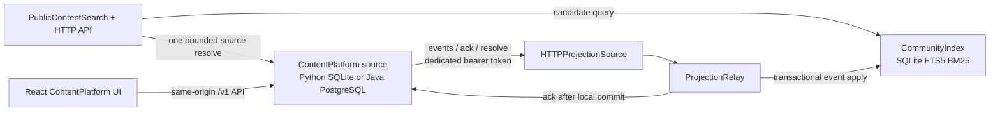

# Architecture and package boundaries

## 组件流

React is currently attached to ContentPlatform endpoints. It does not send search requests to the separate SearchForge Content API. The diagram therefore describes two server paths that share the content source, not a completed C3 search UI.

## Ownership and interfaces

| Component | Owned data and behavior | Public package destination | Boundary |
| --- | --- | --- | --- |
| SearchForge Content | Source HTTP client, bounded relay, source-validated search/detail API | `src/searchforge_content/`, `scripts/`, `contracts/` | Calls ContentPlatform only through the versioned HTTP contract; no source DB connection. |
| SearchForge community index | C3 projection tables, version/event ledger, FTS5 index and BM25 query | `components/searchforge/src/searchforge/community/` | Copied under its component name to preserve origin; no commerce schema or model package is needed for this vertical. |
| ContentPlatform Python source | Account/content API, publication transaction, event source, SQLite default storage | `components/content-platform/src/`, `scripts/` | The source is a bundled reference implementation; the C3 consumer still uses HTTP. |
| ContentPlatform Java source | Java API, PostgreSQL schema, projection endpoints, optional Redis/Kafka features | `components/content-platform/backend-java/` | Separate application and database. Projection route compatibility is documented; the full Java→C3 relay/index path is not evidenced as executed. |
| ContentPlatform React UI | Same-origin account, publish, feed, source search and interaction pages | `components/content-platform/web/` | Build output is generated. Its search route targets ContentPlatform, not the C3 search service. |

Other C1/C2 services are not imported from sibling directories or connected through a shared database. Any future use must name a versioned HTTP contract, authentication boundary and failure behavior; no workstation or deployment address belongs in this package.

## Event and delivery rules

The schema is [`contracts/content-event-v1.schema.json`](contracts/content-event-v1.schema.json). A published event carries schema version, event ID, content ID/version, visibility, author ID, body, timestamps and a source-relative URI.

1. The source writes public content and its immutable projection event in the same transaction.
2. `HTTPProjectionSource.pending()` requests a bounded page of at most 100 events for one configured consumer.
3. `ProjectionRelay.run_once()` commits the event to `CommunityIndex` before calling the source ack endpoint.
4. A lost ack can cause redelivery; event receipts make replay idempotent. This is at-least-once delivery with deduplication, not distributed exactly-once.
5. Search queries are limited to 1–20 results. `PublicContentSearch.search()` makes at most one resolve call for the candidate page and drops absent, non-public, stale-version or changed-body rows before returning them.

The source client accepts plain HTTP only for loopback URLs. Non-loopback source URLs require HTTPS. Redirects and proxy-environment forwarding are disabled so a projection bearer token is not forwarded to another origin.

## HTTP contract

| Method | Path | Use and limit |
| --- | --- | --- |
| GET | `/internal/v1/content-projection/events?consumer_id=…&limit=…` | Read this consumer's unacknowledged immutable events; limit 1–100. |
| POST | `/internal/v1/content-projection/ack` | Idempotently confirm one event for the configured consumer. |
| GET | `/internal/v1/content-projection/content/{content_id}` | Resolve one current public source item. |
| POST | `/internal/v1/content-projection/resolve` | Resolve up to 20 unique content IDs in one request. |
| GET | `/v1/search?q=…&limit=…` | Search current public projections; limit 1–20; source revalidation is mandatory. |
| GET | `/v1/content/{content_id}` | Return current public source details, not a stale indexed copy. |
| GET | `/healthz` | Process liveness only; does not check source or index readiness. |

Projection routes are disabled until the source is configured with a dedicated service token and consumer ID. The projection token is separate from user sessions. The contract's target schema accepts `content.withdrawn`, but the present ContentPlatform source API emits only public `content.published` v1. Index tombstone tests do not establish a working source withdrawal feature.

## Python path audit and standalone layout

The current workspace runner is not standalone. `scripts/content.py` inserts `project_SearchForge/src`; `scripts/verify.py` and `tests/test_integration.py` insert both sibling component paths. The test runner also names tests and hashes source files by workspace-relative sibling paths. These references must be changed per [`PACKAGE_PLAN.json`](PACKAGE_PLAN.json): place the minimal SearchForge community package under `components/searchforge`, and ContentPlatform source under `components/content-platform`, then resolve all imports and test paths from the package root. Preserve the upstream tests below each component directory so their existing `parents[1]/src` setup remains valid.

The C3 runtime modules and the CommunityIndex implementation use Python standard-library facilities. The local source server also has a standard-library SQLite mode; PostgreSQL and Kafka require their declared optional dependencies. There is no need to copy the rest of the SearchForge application, its models, vector stores, or commerce modules to run this content-only API.

## Existing four-method retrieval library

The public package also keeps the minimal existing ReportForge retrieval implementation under `src/searchforge_content/retrieval/reportforge/`: `retrieval.py`, `corpus.py`, `models.py`, and the package initializer. These are copied source files; their relative module imports are preserved. The optional `retrieval` dependency group in `pyproject.toml` follows the source project's declared retrieval dependencies: NumPy, FAISS CPU, and SentenceTransformers.

| Method | Existing implementation | Important boundary |
| --- | --- | --- |
| BM25 | `Retriever.search(method="bm25")` and `_bm25_scores` in `reportforge/retrieval.py` | Pure Python corpus scorer over the library's character-based chunks. |
| Dense | `build_index(backend="faiss")` and `Retriever._dense_scores` | Uses SentenceTransformer embeddings and FAISS inner-product search; weights are external. The fixture backend uses hashed vectors and is not learned retrieval. |
| RRF | `reciprocal_rank_fusion` and `Retriever.search(method="hybrid")` | Fuses BM25 and dense chunk rankings with the existing default k=60. |
| CrossEncoder | `Retriever.search(method="hybrid-rerank")` | Reranks a candidate pool through SentenceTransformers CrossEncoder; weights are external. |

The helper `src/searchforge_content/retrieval/r02/ce_windowing.py` is copied from the R02 benchmark runner and retains overflow-safe full-coverage pairing for a tokenizer-backed reranker. It is a separate helper, not connected to ReportForge's `Retriever`.

These modules preserve existing algorithm code for inspection and use. They are not the C3 `CommunityIndex` API and do not reproduce R02's special query segmentation, full-corpus window aggregation, exact model revisions, private run configuration, or scores. The C3 content endpoint currently remains its separate FTS5/BM25 implementation; no new search method has been wired into that endpoint.

## Java and React runnability

- The Java backend is a separate Spring Boot application using Java 21, Maven and PostgreSQL at runtime. Redis and Kafka are optional configurations. It has an H2-backed integration suite, but an H2 test is not a PostgreSQL migration or live C3 relay/index result.
- The React source is TypeScript and has a committed `package-lock.json`. `npm ci && npm run build` type-checks and creates a Vite bundle, then copies it to `web/app.js`; `index.html` loads that flat asset through `/assets/app.js`. The public package should omit the generated `app.js`, `dist/` and `node_modules/`, and regenerate them locally.
- Java static serving must be configured with `CONTENTPLATFORM_STATIC_ROOT` pointing to the bundled `web/` directory. The Python server uses its component's `web/` folder by default.
- The UI calls same-origin ContentPlatform `/v1/search`; no current frontend adapter or proxy connects it to C3 `/v1/search`.

## Exclusions and data handling

No corpus, qrels, source aliases, SQLite index/database, vector payload, model weights, caches, per-query results, raw logs, launch receipts, personal data or deployment host details are required by this architecture. The package plan lists exact source roots and excludes. The summarized metrics in [`RESULTS.md`](RESULTS.md) keep the evidence categories separate without publishing raw artifacts.
